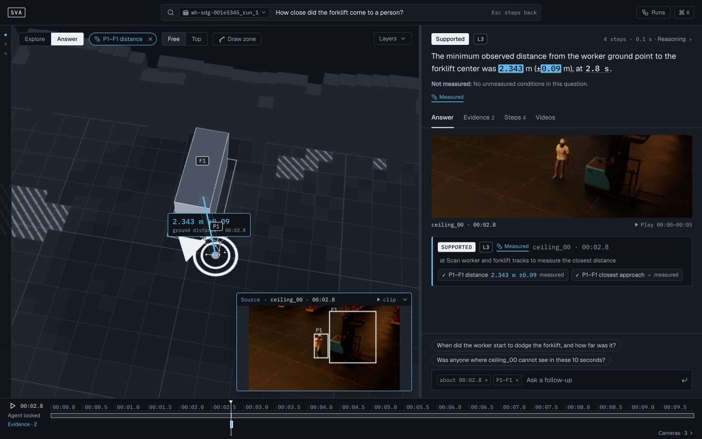
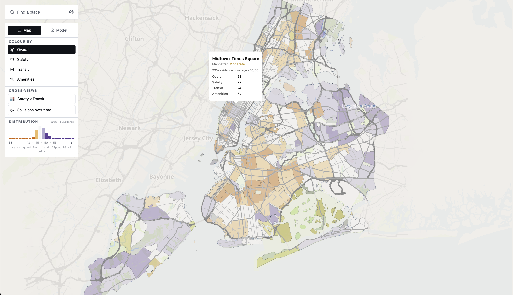

<h3 align="center">AI Engineer · 2027 New Grad · AI/ML & SWE</h3>

Agent Systems · Multimodal AI · Developer Tools NYU MSCS · Expected Dec 2026 · Available Jan 2027 <b>English</b> · <a href="README.zh-Hans.md">简体中文</a> · <a href="mailto:tl4549@nyu.edu">Email</a> · <a href="https://linkedin.com/in/taijia-liang-1151ba265/">LinkedIn</a>

<table>
<tr>
<td width="50%" align="center" valign="top"> <b>Spatial Video Agent · Measured evidence</b></td>
<td width="50%" align="center" valign="top"> <b>Urban Dossier · NYC neighborhood intelligence</b></td>
</tr>
</table>

### 🎬 [Spatial Video Agent](https://github.com/Paradox07127/Spatial-Video-Agent) · Evidence-grounded video investigation

Investigates warehouse, fleet, and street video with Cosmos 3 Nano, Cosmos Embed1, VSS/VastDB, and W&B Inference/Weave.

Links source frames to 3D/map views; numeric claims use CV/geometry or telemetry evidence, with explicit abstention when a scene cannot support an answer. **Real-Time Video Hack finalist.**

<picture><source media="(max-width: 600px)" srcset=".assets/tags-spatial-compact.svg"></picture> <a href="https://github.com/Paradox07127/Spatial-Video-Agent/blob/main/CONTRACT.md">↗ Evidence contract</a> · <a href="https://github.com/Paradox07127/Spatial-Video-Agent#pipeline">↗ GPU pipeline</a>

### 🗺️ [Urban Dossier](https://github.com/Paradox07127/Urban-Dossier) · Local NYC neighborhood intelligence

Local NYC intelligence built on deterministic DuckDB/Parquet/H3 metrics.

Nemotron 3.5 Lightning runs through vLLM in NVFP4, while NemoClaw/OpenShell tools turn supplied evidence into address comparisons and reports. **Spark Hack NYC 2026 participant.**

<picture><source media="(max-width: 600px)" srcset=".assets/tags-urban-compact.svg"></picture> <a href="https://github.com/Paradox07127/Urban-Dossier/blob/main/docs/ARCHITECTURE.md">↗ Architecture</a> · <a href="https://github.com/Paradox07127/Urban-Dossier/blob/main/docs/architecture/PUBLIC_METHODOLOGY.md">↗ Methodology</a>

## 🛠 More projects

### 🖥️ [Loomscreen](https://github.com/Paradox07127/macos-wallpaperengine) · Native macOS rendering & desktop workspace

An independent Metal renderer for Wallpaper Engine scenes on macOS: particles, puppet-warp animation, audio-reactive shaders, and SceneScript.

Per-display render actors power a multi-monitor workspace with video/web wallpapers, synchronized transitions, playlists, and adaptive playback. Lite and Pro are free and open source.

<picture><source media="(max-width: 600px)" srcset=".assets/tags-loomscreen-compact.svg"></picture> <a href="https://github.com/Paradox07127/macos-wallpaperengine/blob/main/docs/en/architecture.md">↗ Architecture</a> · <a href="https://github.com/Paradox07127/macos-wallpaperengine/releases">↗ Releases</a>

### 📊 [Analyst Copilot](https://github.com/Paradox07127/Analyst-Copilot) · Reviewable analysis with bounded agents

Local-first EDA combining deterministic profiling with bounded LangGraph workflows and durable checkpoints.

Typed artifacts, claim ledgers, and evidence gates keep report conclusions reviewable; model-authored Python runs in a separate Docker sandbox. Includes workflow evaluation and self-contained HTML reports.

<picture><source media="(max-width: 600px)" srcset=".assets/tags-analyst-compact.svg"></picture> <a href="https://github.com/Paradox07127/Analyst-Copilot#langgraph-execution-architecture">↗ LangGraph design</a> · <a href="https://github.com/Paradox07127/Analyst-Copilot#agent-harness-and-evaluation">↗ Evaluation harness</a>

### 🧩 [claude-utopia](https://github.com/Paradox07127/claude-utopia) · A workbench for coding agents

Claude Code mods for agent dashboards, model/tool-call timelines, and persistent progress boards.

The mmrun CLI adds cross-model code review and delegation in separate Git worktrees, while workflow guards protect shared work and sensitive configuration.

<picture><source media="(max-width: 600px)" srcset=".assets/tags-utopia-compact.svg"></picture> <a href="https://github.com/Paradox07127/claude-utopia#screenshots">↗ Workbench views</a> · <a href="https://github.com/Paradox07127/claude-utopia#install">↗ Install & options</a>

### 🩺 [Clinical Simulator](https://github.com/Paradox07127/Clinical-Simulator) · Multimodal clinical training

A team-built training platform pairing Gemini patient conversations with rubric-based interview review.

MediaPipe Pose tracks 33 body landmarks for camera-based CPR coaching, movement feedback, and post-session scoring. **Cornell AI Hackathon Grand Prize.**

<picture><source media="(max-width: 600px)" srcset=".assets/tags-clinical-compact.svg"></picture> <a href="https://github.com/Paradox07127/Clinical-Simulator#training-modules">↗ Training modules</a> · <a href="https://github.com/Paradox07127/Clinical-Simulator#product-flow">↗ Product flow</a>

## 🧭 Focus Areas

- 🧠 **Multimodal / Physical AI** — video grounding, spatial reasoning, and measured evidence
- 🧩 **Reliable Agents** — bounded workflows, evidence gates, and evaluation
- ⚙️ **Inference / Systems** — local GPU serving and native graphics

<b>⚙️ Full technical stack</b>

<table>
<tr><td align="right"><b>Languages</b></td><td>

   

</td></tr>
<tr><td align="right"><b>Agents / Models</b></td><td>

   

</td></tr>
<tr><td align="right"><b>Vision / Physical AI</b></td><td>

   

</td></tr>
<tr><td align="right"><b>Inference / GPU</b></td><td>

    

</td></tr>
<tr><td align="right"><b>Data / Retrieval</b></td><td>

    

</td></tr>
<tr><td align="right"><b>Runtime / APIs</b></td><td>

   

</td></tr>
<tr><td align="right"><b>Web / Graphics</b></td><td>

   

</td></tr>
<tr><td align="right"><b>Observability / QA</b></td><td>

  

</td></tr>
</table>

Virginia Tech · B.S. Computer Science · Dec 2024

