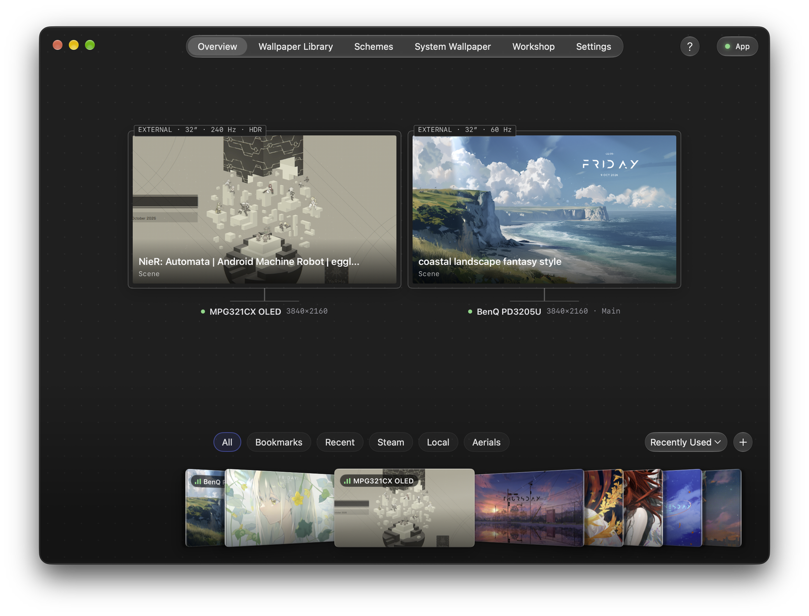

# 梁泰珈

**AI 工程师** · Agent 系统 · 多模态 AI · 开发者工具 纽约大学计算机科学硕士 · 预计 2026 年 12 月毕业 · 纽约 **2027 届校招 · AI / 机器学习与软件工程 · 2027 年 1 月可入职**

[English](README.md) · **简体中文** · [邮箱](mailto:tl4549@nyu.edu) · [LinkedIn](https://linkedin.com/in/taijia-liang-1151ba265/)

 

### 重点项目

<table>
<tr>
<td width="50%" align="center" valign="top"> Spatial Video Agent · 测量与证据</td>
<td width="50%" align="center" valign="top"> Loomscreen · 多显示器场景渲染</td>
</tr>
</table>

**[Spatial Video Agent](https://github.com/Paradox07127/Spatial-Video-Agent)** · 结合 Cosmos 3 Nano、测量证据和 3D / 原始视频视图，完成多摄像头视频调查。 

**[Loomscreen](https://github.com/Paradox07127/macos-wallpaperengine)** · 用 Metal 原生渲染 Wallpaper Engine 场景，支持粒子、骨骼形变、音频响应着色器及每显示器渲染线程。 

### 更多项目

**[Analyst-Copilot](https://github.com/Paradox07127/Analyst-Copilot)** · 通过有界 LangGraph 工作流、claim ledger、证据校验与 Docker 沙箱提供可核查的数据分析。 

**[claude-utopia](https://github.com/Paradox07127/claude-utopia)** · Claude Code 插件，提供 Agent 遥测、mmrun 跨模型审查、工作树委派与工作流保护。 

**[Urban-Dossier](https://github.com/Paradox07127/Urban-Dossier)** · 以 Nemotron 3.5 Lightning（NVFP4/vLLM）、H3 指标及 NemoClaw/OpenShell 工具提供纽约社区情报。Spark Hack NYC 2026 参赛项目。 

**[Clinical-Simulator](https://github.com/Paradox07127/Clinical-Simulator)** · 结合 Gemini 病人问诊、量表评分与 MediaPipe Pose 心肺复苏指导的团队项目。 

### 实习经历

**Founders' Impact** · AI 自动化工程实习生 · `2026 年 9 月 – 至今` 保函承保自动化：材料提取、受限工具调用、证据记录与人工审批。

**中国—东盟信息港** · AI 工程实习生 · `2026 年 1 月 – 3 月` 开发 Dify 单证提取工作流，以及包含意图识别和工具路由的内部知识助手。

<b>完整技术栈</b>

<table>
<tr><td align="right"><b>编程语言</b></td><td>

   

</td></tr>
<tr><td align="right"><b>Agent / 模型</b></td><td>

   

</td></tr>
<tr><td align="right"><b>视觉 / Physical AI</b></td><td>

   

</td></tr>
<tr><td align="right"><b>推理 / GPU</b></td><td>

    

</td></tr>
<tr><td align="right"><b>数据 / 检索</b></td><td>

    

</td></tr>
<tr><td align="right"><b>运行时 / API</b></td><td>

   

</td></tr>
<tr><td align="right"><b>前端 / 图形</b></td><td>

   

</td></tr>
<tr><td align="right"><b>可观测性 / 验证</b></td><td>

  

</td></tr>
</table>

弗吉尼亚理工大学 · 计算机科学学士 · 2024 年 12 月
